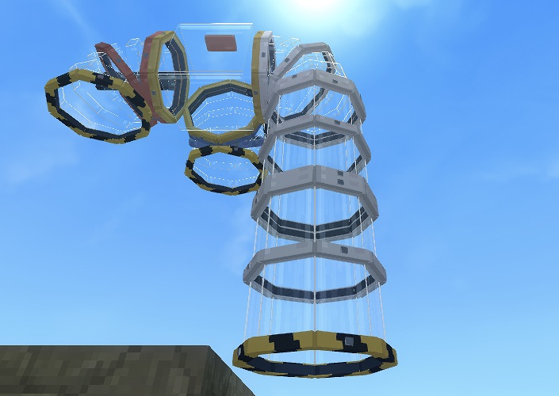

# Slipstream Transit

[Player docs](https://jkswoods.github.io/slipstream-transit/) · [Development releases](https://github.com/jkswoods/slipstream-transit/releases)


Travel through colourful passenger tube networks with automatic boarding, branching routes and named destinations.



- Automatic suction, a smooth shrink transition and a camera facing the journey.
- One-block straights, corners, verticals and rising or descending elbows.
- Three-way splitters, named stops and a destination choice when several stops are reachable.
- Six mix-and-match colours, a Pipe Workbench and warning-striped open mouths.
- Locked movement during travel, with normal size, appearance and controls restored afterward.

[Player guide](docs/index.md) · [Build your first route](docs/getting-started.md) · [Recipes](docs/recipes.md) · [Screenshots](docs/gallery.md) · [Known limits](docs/troubleshooting.md)

## Development status

Source snapshot: **0.1.0-dev.1**.

Targets **Hytale 0.7.3 and Java 25**. This is a development preview, with one passenger per world, 128 registered parts and up to 64 parts per journey. Routes require loaded chunks and a single builder. Other players may ride; a real second-client session and survival ingredient deduction still need verification. Keep a complete backup and use a test world.

Screenshots show the C7 gameplay preview in a separate showcase copy. They are native game captures, cropped to the feature or UI. No world or player save is included.

## Build

Provide your own official Hytale 0.7.3 server JAR and JDK 25. The proprietary server and game assets are not redistributed.

```sh
export ST_SERVER_JAR=/path/to/HytaleServer.jar
export ST_JAVA_HOME=/path/to/jdk-25
python3 tools/build.py
python3 tools/check.py
```

The JAR is written to `build/libs/`. See [installation](docs/installation.md) before trying it in a world.

## Documentation

```sh
python3 -m venv .venv-docs
.venv-docs/bin/python -m pip install -r requirements-docs.txt
.venv-docs/bin/python -m mkdocs serve
```

Pushes to `main` build and publish the [player guide](https://jkswoods.github.io/slipstream-transit/). Pull requests build the docs without deploying. Download the initial **0.1.0-dev.1** preview from [Releases](https://github.com/jkswoods/slipstream-transit/releases/tag/v0.1.0-dev.1). Code and original project assets are available under the [MIT licence](LICENSE); see [third-party notices](THIRD_PARTY_NOTICES.md).

## Compatibility and builds

Current source targets Hytale `>=0.7.3 <0.8.0` and uses the `hytale0.7` support branch. See [build and release instructions](docs/build-and-release.md) for the SDK pin, candidate checks, versioned filenames and CurseForge workflow.
