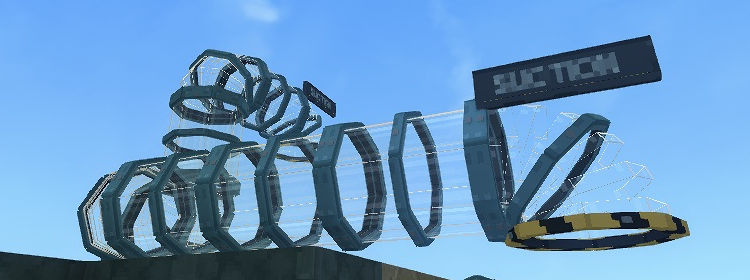
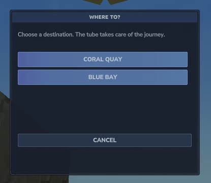

# Through the glass

Native Hytale screenshots from the C7 gameplay preview. The showcase copy exposes the tubes so their shapes and connections are visible. These are cropped game captures, without chat or player account details.

## One intake, two destinations

*The white straight sucker feeds the gold junction. Blue and coral elbow stations make the two upper destinations.*

## Mixed colours, matching ports

*Different colours connect directly. Yellow-and-black rims mark the open mouths.*

## Around a corner, up a level

*Use elbows and verticals to change direction within a one-block footprint.*

## The pipe workshop

*Every colour has the same set of shapes and costs.*

## Pick a stop

*The chooser appears automatically when more than one stop is reachable.*

[Build your own route](getting-started.md)
