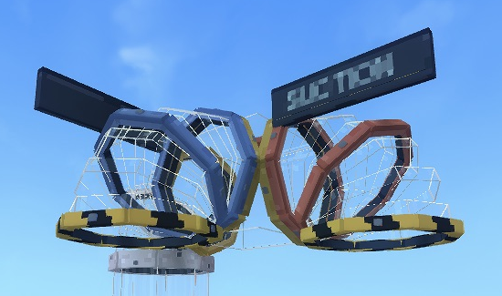

# Take the tube

Hytale 0.7.3 · Development preview

Build a shortcut you can see through. Step beneath an open intake, shrink into the tube and travel in first person to your next stop.

*One straight intake, two destinations. Mix colours freely as you build.*

<a href="getting-started/">Build your first route →</a><a href="recipes/">See the recipes →</a>

## Start small. Branch out.

Craft a **Pipe Workbench** from iron and copper. Connect two suckers with straight tubes, corners and verticals, then walk beneath one to ride. Add a splitter and a third named stop when you want a choice of destinations.

There is no boarding key, power supply or fare. The intake draws you in automatically; the tube controls movement until you reach full size at the other end.

*Warning stripes mark the open mouths. F opens naming; approaching the mouth starts travel.*

## Before you install

Use a test world and keep a full backup. The preview supports **one passenger per world**, **128 parts per world** and **64 parts per journey**. Routes stay within loaded chunks and all connected parts must share a builder. Real second-client multiplayer and survival ingredient deduction are not verified yet.

[Installation and compatibility](installation.md) · [Controls and first steps](getting-started.md) · [More screenshots](gallery.md)
