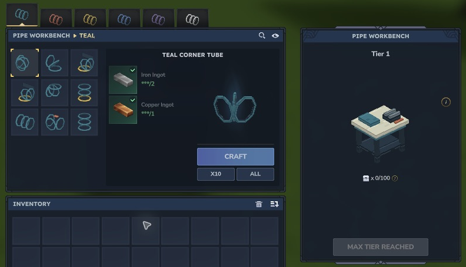

# Pipe workshop recipes

Make the Pipe Workbench at the standard Workbench. All remaining Slipstream recipes use its six colour tabs. Each recipe produces **one item**, with the same cost in every colour.

| Item | Iron Ingots | Copper Ingots | Craft time |
| --- | ---: | ---: | ---: |
| Pipe Workbench | 6 | 4 | 3 s |
| Straight Tube | 2 | 1 | 2 s |
| Corner Tube | 2 | 1 | 2 s |
| Rising Elbow | 2 | 1 | 2 s |
| Descending Elbow | 2 | 1 | 2 s |
| Vertical Tube | 2 | 1 | 2 s |
| Tube Splitter | 3 | 2 | 2 s |
| Harbour Station | 4 | 2 | 2 s |
| Overlook Station | 4 | 2 | 2 s |
| Straight Sucker Station | 4 | 2 | 2 s |

*Teal, coral, gold, blue, violet and white each have the same nine shapes: 54 pipe and station variants, plus the workbench.*

Crafting uses the native Hytale bench and inventory system. The recipe definitions and Creative crafting have been checked; survival ingredient deduction still needs verification.
